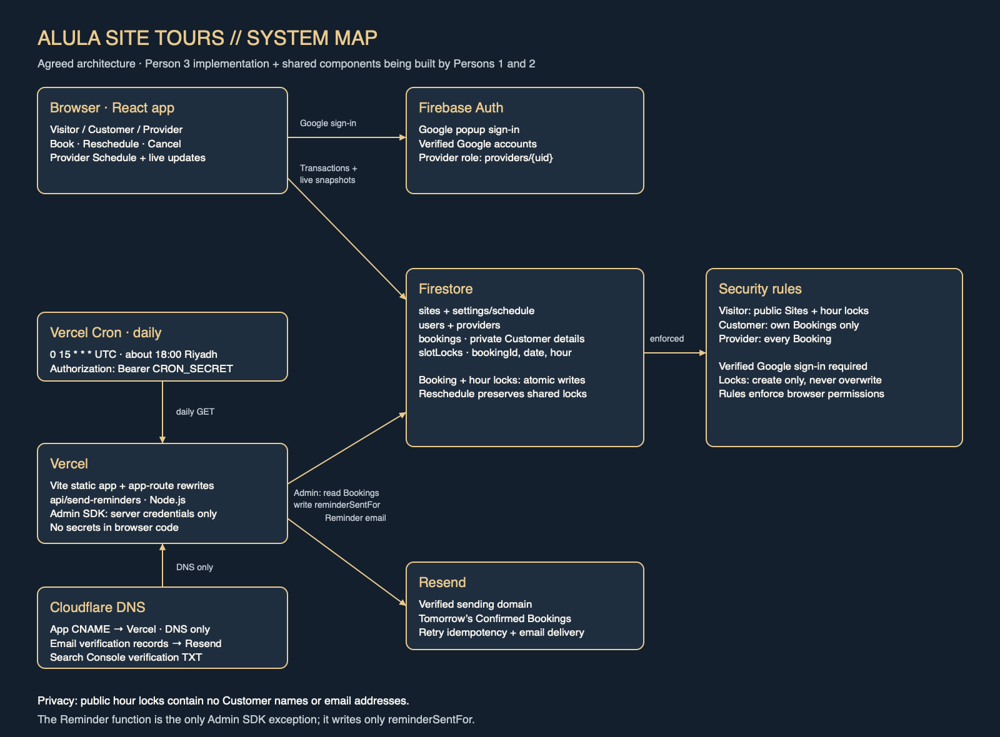

# AlUla Site Tours

Private guided trips to Elephant Rock, AlUla Old Town, Hegra and Harrat Viewpoint. One Provider manages one Schedule shared across all Sites. Customers book their own group; Party Size never changes which Slots are open.

**Live URL:** not deployed yet. The integration branch `two+3` includes Person 2's Firebase implementation, Person 3's Provider page and Reminder function, and Person 1's HTML design mockups. The Customer React screens and app routing are still pending; the current app entry shows the Vite starter.

## Stack and ownership

Vite, React, TypeScript, React Router, Tailwind CSS, Firebase Google sign-in and Firestore. Vercel hosts the app and a Node.js Reminder function. Cloudflare manages domain DNS; Resend delivers email.

| Person | Owns |
| --- | --- |
| 1 | App skeleton, Customer and Visitor screens, routes, shared UI |
| 2 | Firebase, shared types and functions, scheduling, transactions, rules and indexes |
| 3 | Vercel, Provider screen, Reminders, domain/search setup, diagram, evidence and demo |

## How it works



The [editable Excalidraw diagram](docs/system-diagram.excalidraw) shows the agreed architecture. The Customer screens and app routing from Person 1 are still being built.

Person 1's Rihlatna design reference is in `design/`: Home, Book and My trips mockups with Arabic/English text, theme controls and 17 WebP images. With `npm run dev` running, open `/design/index.html` to view them. They use hard-coded example data and still need to be connected to the shared Firebase functions in React.

For the Provider interface, open `/provider-preview.html` on the dev server. It uses the same view as the real Provider page with labelled sample data. Filters, details, cancellation, completion and Reset samples work in memory. This preview does not import Firebase or require sign-in/configuration. The real `ProviderSchedule` wrapper continues to use Firebase authentication and Booking operations.

Slots are calculated from Operating Hours and the Booking Window. A Booking claims one Firestore `slotLocks` record per hour in a transaction. Locks can be created but never overwritten, preventing overlaps across every Site. Rescheduling preserves shared hours and swaps the remaining locks atomically; cancellation releases locks in the same batch as its status change. Person 2's implementation and [access-test evidence](docs/evidence/access-tests.md) are included.

| Role | Access enforced by Firestore rules |
| --- | --- |
| Visitor | Sites, Schedule settings and taken-hour locks; no Customer details |
| Customer | Own Bookings; book, cancel or reschedule before the trip starts |
| Provider | All Bookings; cancel and mark Completed |

## Person 3 implementation

- `vercel.json`: Vite build, app-route refreshes excluding `/api`, and daily cron.
- `api/send-reminders.ts`: authenticated Reminders, Riyadh dates, escaped email content, retry idempotency and conditional sent markers.
- `src/pages/provider/ProviderSchedule.tsx`: live Schedule, filters, details, cancellation confirmation and completion.
- `index.html`, `public/robots.txt`, `public/sitemap.xml`: metadata and crawl assets. The sitemap host remains a placeholder until the production address is known.

Follow [Person 3 setup](docs/part3-setup.md) for service configuration and integration, then use the [demo runbook](docs/demo-runbook.md).

## Run locally

Install Node.js 24.12 or newer within the 24.x release line, matching the package requirement:

```sh
npm install
cp -n .env.example .env.local
# Fill in Person 2's VITE_FIREBASE_* settings in .env.local.
npm run dev
```

Vite currently serves the starter page until Person 1's screens and routes arrive. The Provider component is ready for their `/provider` route. Real sign-in and data access need populated Firebase browser settings. The Reminder endpoint runs on Vercel. Keep the service account, email key and cron secret in Vercel's environment settings, never in browser code or variables prefixed with `VITE_`.

## Verification

All **40 tests pass in the merged checkout**: 11 scheduling, 17 Reminder, 10 Provider and 2 Provider-preview tests. The app and separate Provider preview builds pass with the retained React 18, TypeScript 5.6 and Vitest 2 setup. See [preview verification](docs/evidence/preview-verification.md), [all-three integration evidence](docs/evidence/all-three-integration.md) and the earlier [Part 2 integration evidence](docs/evidence/part2-person3-integration.md). Provider tests mock data responses; live Google sign-in, Provider writes and email delivery remain pending.

The earlier [isolated verification](docs/evidence/part3-verification.md) is retained as historical evidence.

After `npm install`:

```sh
npm test -- --run
npm run build
```

## Trade-offs and known limitations

- No travel time between Sites, payments, Provider rescheduling or editing Operating Hours in the UI.
- Scheduling is checked in the browser; the planned rules prevent overlapping locks but do not prove consecutive hours or Operating Hours. See [ADR 0001](docs/adr/0001-calculated-slots-and-hour-locks.md).
- Customer and Provider actions go straight to Firestore. Reminders are the one Admin SDK exception. See [ADR 0002](docs/adr/0002-no-server-code-rules-enforce-access.md).
- The Reminder job is scheduled at 18:00 Riyadh. On Hobby it can run later within that hour. Bookings made or rescheduled for tomorrow after the run get no automatic Reminder. See [ADR 0003](docs/adr/0003-reminders-via-daily-vercel-cron.md) and [Vercel's timing documentation](https://vercel.com/docs/cron-jobs/manage-cron-jobs#cron-jobs-accuracy).
- An email already being sent can contain the previous time after a concurrent Reschedule. It cannot mark the new time as reminded. Resend's retry keys last 24 hours; the persisted Firestore marker provides deduplication afterwards. See [Resend's idempotency documentation](https://resend.com/docs/dashboard/emails/idempotency-keys).
- `watchBookingsForDate` has no asynchronous error callback. The Provider page bounds the initial wait; errors after a successful snapshot need a contract extension from Person 2.

## Change request

Not announced. Nothing has been implemented in anticipation of it. Person 2 leads the change after the team agrees its scope.

## References

[Glossary](CONTEXT.md) · [MVP plan](docs/mvp-plan.md) · [Team plan](docs/team-plan.md) · [Competition](https://acmchapter-psu.github.io/acm-webforge-2026/competition.html)

Original team notes: ABDELRAHMAN WAS HERE! · ABDULMOHSEN WAS HERE!
